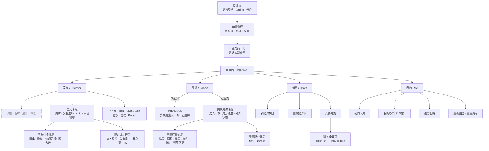

# 00 · 全球版（香港基线）产品现状

> 本文档只描述**当前代码里已经实现的东西**，作为后续三份中国大陆文档的对比基线。
> 依据：`src/App.tsx`、`src/screens/*`、`src/components/*`、`src/data/*`、`src/i18n.tsx`、`src/styles.css`、`video/film/film.js`（路演稿）。全部为只读分析，未改动任何源文件。

---

## 1. 产品定位（一句话）

**先滑到一个室友，再和 TA 一起滑到一间房。**

- 路演定稿文案：`先滑到一个室友，再一起滑到一间房。`（[video/film/film.js:214](file:///d:/Agent/Roommix/video/film/film.js#L214)）
- 英文 tagline：`Swipe for a roommate. Then swipe for a room.`（[video/film/film.js:197](file:///d:/Agent/Roommix/video/film/film.js#L197)）
- 首页副标语：`在香港，找室友比找 fwb 还尴尬。回答 10 个问题，然后开始滑。`（[src/i18n.tsx:26-35](file:///d:/Agent/Roommix/src/i18n.tsx#L26-L35)）
  - 注意：路演简中稿已刻意**不提 fwb / Tinder**，改用"你用过交友软件吗？就是左右滑那种"（[video/film/film.js:114-131](file:///d:/Agent/Roommix/video/film/film.js#L114-L131)）。这条修改理由（大陆接受度）本身就是一条本地化证据。

## 2. 核心机制：双阶段配对

| 阶段 | 决策对象 | 判定规则 | 代码位置 |
| --- | --- | --- | --- |
| 第一阶段 | 人（室友候选） | 你右滑 + 对方 `likesYou` → 配对成功 | [src/screens/Discover.tsx:23-36](file:///d:/Agent/Roommix/src/screens/Discover.tsx#L23-L36) |
| 第二阶段 | 房（房源） | 你右滑 + 对方 `partnerLikes` → 房源配对 | [src/screens/Rooms.tsx:75-98](file:///d:/Agent/Roommix/src/screens/Rooms.tsx#L75-L98) |

第二阶段是产品的**独占设计**：两人共享同一副房源卡组，对方以节流器（每 2.6s 前进一张、通常领先你 1–2 张）模拟"实时一起刷"，卡片顶部显示对方的 `正在看… / 已决定` 状态；你和他决策不一致时用 toast 给出对方的理由（"没电梯，搬家会累死"）。见 [src/screens/Rooms.tsx:59-64](file:///d:/Agent/Roommix/src/screens/Rooms.tsx#L59-L64)、[src/data/rooms.ts:67](file:///d:/Agent/Roommix/src/data/rooms.ts#L67)。

## 3. 契合度算法（当前唯一"算法"）

10 道题，每题按 `same / close / differ` 三档判定，加权求和映射到 **52–98 分**区间：

- 判定函数 `compareAnswer`：相邻选项算 `close`；但吸烟者对"不吸烟"、过敏者对"养宠"直接判 `differ`（硬冲突优先）——[src/data/questions.ts:159-180](file:///d:/Agent/Roommix/src/data/questions.ts#L159-L180)
- 权重：`sleep 1.4 / clean 1.4 / smoke 1.3 / budget 1.3 / pets 1.2 / area 1.2 / guests 1.1 / shower·food·calls 1.0`——[src/data/questions.ts:184-198](file:///d:/Agent/Roommix/src/data/questions.ts#L184-L198)
- 卡片上只露出 5 个 chip（第一张照片）+ 5 个 chip（第三张之后），详情页展示全部 10 行的对照表 + `N / 10 一致`——[src/components/Cards.tsx:125-136](file:///d:/Agent/Roommix/src/components/Cards.tsx#L125-L136)、[src/components/Details.tsx:152-174](file:///d:/Agent/Roommix/src/components/Details.tsx#L152-L174)

10 道题现有内容（香港口径）：作息、洗澡时间、爱干净程度、冰箱食物、访客过夜、在家打电话、宠物、烟酒、**每人每月租金预算（HK$6k / 6–9k / 9–12k / 12k+）**、**想住区域（港岛 / 九龙 / 新界 / 近港铁就行）**。

## 4. 主要功能 / 次要功能清单

### 主要功能（已实现，构成完整闭环）

| # | 功能 | 现状 |
| --- | --- | --- |
| M1 | 10 题生活习惯测评 → 生成"我的卡片" | 完成。单选自动进下一题、多选可勾选、"跳过"直接用示例答案；生成页有雷达加载动画 |
| M2 | 室友卡片流 + 滑动决策 | 完成。拖拽 + 5 个按钮（撤回 / 不要 / 超级喜欢 / 喜欢 / Boost）、LIKE-NOPE-SUPER 印章、照片分段点击、震动反馈、电脑演示键盘快捷键 |
| M3 | 契合度可视化 | 完成。环形进度 + 加权分数 + 卡片 chip 上的三档标记 |
| M4 | 双向配对 + 配对庆祝 | 完成。全屏 Match overlay（照片飞入 + 粒子迸发 + 直接发消息） |
| M5 | 双人共享房源卡组（一起刷房） | 完成。对方状态实时可见、预算是否符合双方（`budgetFits`，容差 5%）、房源"统一格式"标识 + 来源 |
| M6 | 房源详情 + 房源配对 + 预约看房 | 完成。详情半屏抽屉（图集 / 格局 / 实用面积 / 楼层 / 地区 / 港铁 / 可入住时间 / 特征 chip），房源配对后 CTA"预约一起看房" |
| M7 | 聊天（配对后才可对话） | 完成。新配对横排、房源配对卡、消息列表、全屏聊天页、"正在输入"、对方自动回复（最多 2 条） |
| M8 | 三语（简 / 繁 / EN） | 完成。文案层与数据层都做了本地化；按 `localStorage` + `navigator.language` 自动判定 |
| M9 | "我的"页：卡片 / 答案回看 / 重新回答 | 完成 |

### 次要功能（占位 / 未实现——演示时会看到空壳）

| # | 位置 | 现状 |
| --- | --- | --- |
| S1 | 顶部通知铃 | 点击只弹 toast，文案是筛选内容（[src/screens/Discover.tsx:46](file:///d:/Agent/Roommix/src/screens/Discover.tsx#L46)） |
| S2 | 顶部筛选（sliders） | 同上，仅 toast：`筛选：港岛 · HK$6k–12k · 不吸烟` |
| S3 | Boost（闪电图标） | 仅 toast：`⚡ Boost 已开启：未来 30 分钟优先展示` |
| S4 | 超级喜欢 | 仅 toast，不改变对方是否喜欢你 |
| S5 | 认证徽章 | 数据字段 `verified: boolean` + `IconVerified`，**8 人里 7 人为 true**，无认证流程、无徽章类型区分 |
| S6 | 职业 / 学历展示 | 只有单行文本 `job`（如"软件工程师 · 远程""港大研究生"），无公司/学校结构化字段，无认证 |
| S7 | 性别 | **完全没有性别字段**（`Person` 里没有 `gender`），匹配也无性别维度 |
| S8 | 注册 / 登录 / 手机号 | 无（纯静态站，无后端、无账号） |
| S9 | 上传照片 / 编辑资料 | 无（卡片照片来自本地 `me/me2/me3`，人物资料为写死的虚构数据） |
| S10 | 真实房源供给 | 无。8 套房源、来源平台名（SquareNest / HomeHub HK / Spacebox / 业主直租）均为虚构 |
| S11 | 举报 / 拉黑 / 客服 / 风控 | 无 |
| S12 | 定位 / 地图找房 | 无，只有"区域"这一粗粒度维度 |
| S13 | 支付 / 合同 / 押金 | 无（路演稿把"租约我们处理、照片不符我们解决、合不来退款"作为付费理由，但产品内无对应流程） |

### 商业化设定（仅出现在路演稿，产品内未实现）

1. 用户付租金的 **2%**，最多收 6 个月，配套三项保障（租约处理 / 房照不符兜底 / 室友合不来上传新合约后退款）；
2. 平台方付费把房源放进卡组，所有房源统一成一种格式；
3. 增值服务（"配对成功之后你需要的一切"）。
见 [video/film/film.js:169-189](file:///d:/Agent/Roommix/video/film/film.js#L169-L189)。

## 5. 导航栏（现状）

**四标签底部栏**（[src/App.tsx:116-121](file:///d:/Agent/Roommix/src/App.tsx#L116-L121)）：

| 顺序 | id | 简中 | 繁中 | EN | 图标 | 徽标逻辑 |
| --- | --- | --- | --- | --- | --- | --- |
| 1 | `discover` | 室友 | 室友 | Roommates | LogoMark（品牌图形，选中时渐变） | — |
| 2 | `rooms` | 房源 | 房源 | Rooms | IconRooms | 有搭档且不在本页时显示**小圆点** |
| 3 | `chats` | 消息 | 訊息 | Chats | IconChat | 配对数 > 0 且不在本页时显示**数字角标**（弹入动画） |
| 4 | `me` | 我的 | 我的 | Profile | IconPerson | — |

标签页不卸载重挂：`tab-pages` 用 `hidden` 切换显示，房源页按 `partnerId` 重建。二级页（聊天详情、卡片详情抽屉、Match 全屏浮层）都以覆盖层形式出现，不进导航栈。

## 6. 信息架构图（全球版现状）

`*` = 图标存在但功能未实现（占位 toast）。

## 7. 视觉语言（现状）

| 元素 | 取值 | 位置 |
| --- | --- | --- |
| 品牌渐变 | `#ff4f6d → #ff6a55 → #ff9a3d`（珊瑚红→橙） | [src/styles.css:13-15](file:///d:/Agent/Roommix/src/styles.css#L13-L15) |
| 语义色 | 喜欢 `#19d489` / 不要 `#ff4458` / 超级喜欢 `#2fa4ff` / 撤回 `#f7b500` / Boost `#a75cff` | 同上 L21-25 |
| 文字色 | 主 `#21262e` 次 `#58606b` 灰 `#7c8591` 描边 `#eceef1` 底 `#f4f5f7` | 同上 L16-20 |
| 字体 | 系统栈（SF / PingFang SC / Microsoft YaHei / Noto Sans SC），繁中切 PingFang HK 优先；配对标题用自托管手写体 Kaushan Script（仅为在墙内可访问而本地化字体，不依赖 Google Fonts） | [src/styles.css:1-57](file:///d:/Agent/Roommix/src/styles.css#L1-L57) |
| 卡片 | 竖版全幅照片 + 底部渐变蒙层 + 白色文字叠加；顶栏 chip、契合度环、右上 info 圆钮；照片进度条 | [src/components/SwipeDeck.tsx:348-392](file:///d:/Agent/Roommix/src/components/SwipeDeck.tsx#L348-L392) |
| 组件词汇 | `btn-grad`（渐变主按钮）/ `btn-white` / `btn-outline` / `btn-ghost` / `pill-grad` / `chip`（三档状态）/ `sheet`（底部抽屉）/ `overlay`（全屏庆祝）/ `toast` | 全项目 |
| 动效 | Motion 弹簧为主（stiffness 220–600）、粒子迸发、chip 逐条弹入、震动 8ms、图片预加载/预热 | [src/components/SwipeDeck.tsx](file:///d:/Agent/Roommix/src/components/SwipeDeck.tsx)、[src/data/photos.ts](file:///d:/Agent/Roommix/src/data/photos.ts) |
| 适配 | 100vh + `env(safe-area-inset-*)`、禁用长按选中、`viewport-fit=cover`、`theme-color #ff4f6d` | [index.html](file:///d:/Agent/Roommix/index.html) |

整体基调 = **社交产品借租房场景**：年轻、饱和、动效浓，靠真实照片（而非插画）建立可信度。

## 8. 技术形态（影响上线节奏）

- Vite + React 19 + Motion 14，纯前端静态站，**无后端、无数据库、无鉴权**；已配 Cloudflare Workers / Pages 部署脚本（[wrangler.jsonc](file:///d:/Agent/Roommix/wrangler.jsonc)）。
- 演示脚本全靠数据字段硬编码（`likesYou`、`partnerLikes`、`partnerReason`），聊天回复是本地定时器。
- 中国大陆上线需要额外解决：ICP/App 备案、域名与 CDN 在墙内可达、字体与第三方资源已本地化（已做）、以及**服务端与真实数据**（当前完全没有）。

## 9. 本地化改造必须触碰的现状缺口（结论先行）

| 缺口 | 为什么在大陆是硬伤 |
| --- | --- |
| 无性别字段与性别筛选 | 大陆合租场景"限男女生/女生"是高频筛选条件，也是女性用户安全前提 |
| 认证只有一个布尔字段 | 大陆用户对"对面是不是骗子/中介冒充房东"的敏感度远高于香港，且平台有房源真实性核验义务 |
| 预算单位是 HK$、区域是港岛/九龙/新界 | 需改为人民币 + 行政区/商圈/地铁线口径 |
| 无手机号登录、无实名 | 大陆网络实名制要求，且是防骗的第一道闸 |
| 无举报/拉黑/内容审核 | UGC + 私聊在大陆属于强监管面 |
| 房源来源是虚构平台 | 大陆需要真实供给来源与"房源核验"表述 |
| 首页 tagline 用"fwb"梗 | 简中路演稿已改写，正式文案需全面回避 |

---

*配套文档：`01-竞品分析.md` · `02-中国大陆功能设计与全球版差异.md` · `03-中国大陆项目背景-市场与趋势.md` · `04-本地化功能实现调研-认证与真人核验.md`*
